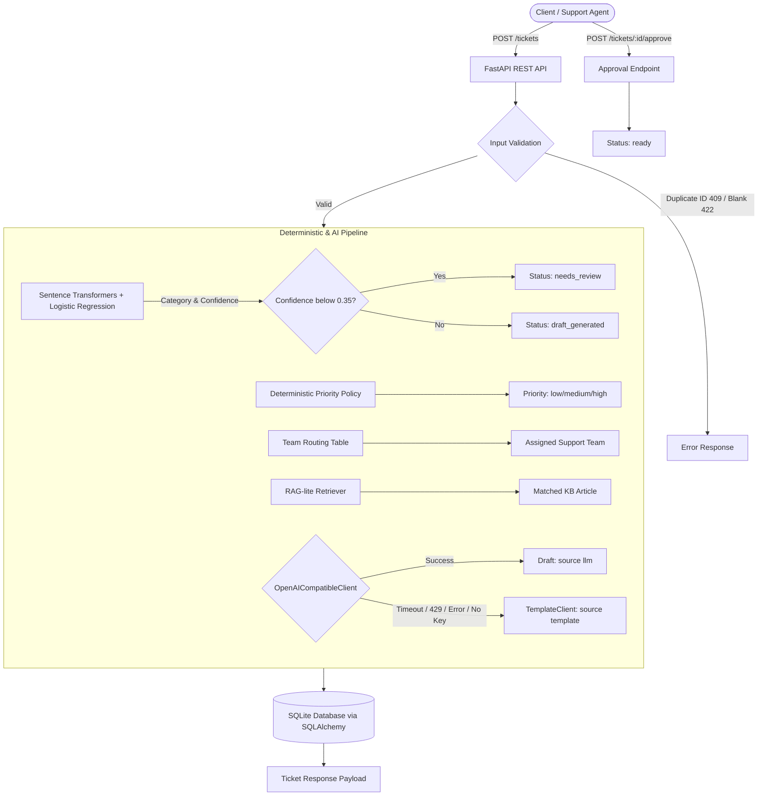

# Azure Support Ticket Automation (Problem PS04)

[](https://github.com/MADHUSUDANnnnnn/Cerevyn-Chitkara-2310990812-PS04/actions/workflows/ci.yml)
[](https://www.python.org/downloads/release/python-3110/)
[](https://fastapi.tiangolo.com/)
[](https://opensource.org/licenses/MIT)

> **Cerevyn Technical Assessment — Problem Statement PS04**  
> **Candidate**: Madhusudan Mudgal  
> **Institution**: Chitkara University  
> **Degree & Branch**: B.E. Computer Science and Engineering (CSE)  
> **Roll Number**: 2310990812  

---

## Submission Links

> **Fill these in before submitting — they are placeholders.**

| Item | Link |
| :--- | :--- |
| **CI run (green)** | `<paste link to the passing GitHub Actions run>` |
| **Demo recording (3–5 min)** | `<paste link>` |
| **Final commit hash evaluated** | `<paste hash>` |
| **Screenshots** | [`docs/screenshots/`](docs/screenshots/) — add: `docker_ps_healthy.png`, `live_llm_draft.png`, `template_fallback.png`, `approval_flow.png` |

---

## 1. Problem Statement & Objectives

In high-volume cloud support environments, incoming tickets often suffer from inconsistent classification, arbitrary priority escalation, and generic hallucinated automated responses.

The objective of **Problem PS04** is to build a reliable, auditable, AI-assisted REST API that:
1. Accepts raw customer support messages.
2. Statistically classifies them into categories (**Billing**, **Technical**, **Access**, **General**) using sentence embeddings and logistic regression.
3. Routes uncertain classifications (confidence below cross-validation threshold) to a `needs_review` state.
4. Deterministically assigns priority (**low**, **medium**, **high**) based on documented business rules, completely independent of LLMs.
5. Maps tickets to specialized teams (`Finance Support`, `Engineering Support`, `IT Security / Identity`, `Customer Care`).
6. Grounds draft replies and internal summaries in official knowledge-base articles via RAG-lite vector similarity, forbidding hallucination.
7. Holds all drafts for **explicit human approval** before marking them `ready`. No real emails are dispatched.
8. Enforces provider-agnostic OpenAI-compatible integration with seamless offline fallback to deterministic templates.

---

## 2. Architecture & Pipeline



### Key Design Highlights
- **Strict Separation of Concerns**: Routing and priority are 100% deterministic and ML-driven. The LLM is never given authority over category or priority.
- **Provider-Agnostic LLM Layer**: Configurable to Groq, Azure OpenAI, or local gateways via environment variables (`GROQ_API_KEY`, `LLM_BASE_URL`, `LLM_MODEL`).
- **Resilient Fallback**: Zero external dependencies needed to run tests or start up. The app falls back gracefully to `TemplateClient` if the key is missing or the provider fails.
- **Human-in-the-Loop**: Drafts cannot reach `ready` status without an explicit approval API call.

---

## 3. Technology Stack & Pinned Dependencies

| Component | Library / Framework | Version | Purpose |
| :--- | :--- | :--- | :--- |
| **Runtime & Core** | Python | `3.11.16` | Robust, modern Python runtime |
| **Web Framework** | FastAPI | `0.115.6` | Asynchronous high-performance REST API |
| **ASGI Server** | Uvicorn (standard) | `0.34.0` | Production ASGI web server |
| **Data Validation** | Pydantic / Pydantic Settings | `2.10.4` / `2.7.0` | Strict schemas and env configuration |
| **ORM & Database** | SQLAlchemy | `2.0.36` | Database schema and query abstraction |
| **Embeddings** | Sentence-Transformers | `3.3.1` | Dense semantic text representations (`all-MiniLM-L6-v2`) |
| **Machine Learning**| scikit-learn | `1.6.0` | Logistic regression, CV tuning, metrics |
| **Data Analysis** | Pandas & NumPy | `2.2.3` / `2.2.1` | Tabular ticket dataset processing |
| **LLM Client** | OpenAI Python SDK | `1.58.1` | Provider-agnostic chat completions |
| **HTTP Client** | HTTPX | `0.28.1` | Async HTTP client for OpenAI SDK |
| **Test Engine** | Pytest / Pytest-Cov | `8.3.4` / `6.0.0` | Unit & integration testing |

---

## 4. Setup & Local Installation

### Prerequisites
- macOS (Apple Silicon / Intel) or Linux
- Python 3.11 installed (or managed via `uv`)
- Docker Desktop (optional, for containerization)

### Step 1: Clone and Create Virtual Environment
```bash
git clone https://github.com/MADHUSUDANnnnnn/Cerevyn-Chitkara-2310990812-PS04.git
cd Cerevyn-Chitkara-2310990812-PS04

# Using standard venv
python3.11 -m venv .venv
source .venv/bin/activate

# Or using uv (recommended for ultra-fast setup)
uv venv --python 3.11 .venv
source .venv/bin/activate
```

### Step 2: Install Pinned Dependencies
```bash
pip install -r requirements.txt
```

### Step 3: Configure Environment Variables
Copy `.env.example` to `.env`:
```bash
cp .env.example .env
```
*(Note: `.env` is listed in `.gitignore` and is never committed to Git).*

---

## 5. Using a Free Gateway (LLM Configuration)

The application functions completely without any external API key. However, to enable live generative drafts, three presets are supported:

### Preset A: Groq Direct (Recommended for Free High-Speed Inference)
1. Sign up for a free key at [Groq Cloud Console](https://console.groq.com/).
2. In `.env`, configure:
   ```env
   LLM_BASE_URL=https://api.groq.com/openai/v1
   GROQ_API_KEY=gsk_your_actual_groq_api_key
   LLM_MODEL=<model id from your provider console>
   LLM_TIMEOUT_SECONDS=10.0
   LLM_TEMPERATURE=0.2
   ```
   > **Note**: The author tested with `openai/gpt-oss-20b` on Groq. Model names change
   > frequently — always verify the current model ID in the [Groq Cloud Console](https://console.groq.com/)
   > before setting `LLM_MODEL`.

### Preset B: Local OmniRoute / LiteLLM / Ollama Gateway
1. Start your local OpenAI-compatible proxy (e.g. LiteLLM on port 8080).
2. In `.env`, configure:
   ```env
   LLM_BASE_URL=http://localhost:8080/v1
   GROQ_API_KEY=local-dummy-key
   LLM_MODEL=local-model-name
   ```

### Preset C: Zero Key Mode (Deterministic Template Fallback)
Leave `GROQ_API_KEY=` blank or unset. The app automatically utilizes `TemplateClient` for all summaries and drafts.

> **Privacy Notice**: Only fictional support ticket data is processed. For enterprise deployments, use **Azure OpenAI Service** within a private VNet with keys stored in **Azure Key Vault** (see [docs/azure-plan.md](docs/azure-plan.md)). Third-party gateways are intended for candidate demo purposes only.

---

## 6. How to Run the Application

Start the development server using Uvicorn:
```bash
uvicorn app.main:app --host 0.0.0.0 --port 8000 --reload
```

The interactive OpenAPI documentation is available at:
- Swagger UI: [http://localhost:8000/docs](http://localhost:8000/docs)
- ReDoc: [http://localhost:8000/redoc](http://localhost:8000/redoc)

---

## 7. How to Test

Execute the full automated test suite (36 tests covering API validation, classifier, health/LLM configuration, lifecycle, team routing, priority rules, and LLM fallbacks):
```bash
pytest -v
```

To run with test coverage reporting:
```bash
pytest --cov=app --cov-report=term-missing
```

---

## 8. Dataset & Model Evaluation

### Data Partitioning (Strict Separation)
- `data/tickets_labelled.csv`: Exactly 30 labeled fictional support tickets.
- `scripts/split_data.py`: Splits the dataset into:
  - `data/train_set.csv`: **20 tickets** used for model fitting and 4-fold cross-validation.
  - `data/test_set.csv`: **10 locked tickets** (stratified split with seed `42`).
- **Guarantee**: The test set was locked before hyperparameter exploration and was **never** used for training or threshold tuning.

### Run Benchmark Evaluation
```bash
python scripts/evaluate.py
```

### Real Evaluation Benchmark Results

| Metric | Sentence Embeddings + Logistic Regression | Keyword Rule Baseline |
| :--- | :--- | :--- |
| **Test Accuracy** | **90.0%** (9/10) | **100.0%** (10/10) |
| **Train 4-Fold CV Accuracy** | **60.0%** | N/A |
| **Best Hyperparameter $C$** | **2.0** (tuned on train set) | N/A |
| **Calibrated Threshold** | **0.35** (OOF 10th percentile) | N/A |
| **Mean Test Confidence** | **0.3686** | N/A |
| **Routed to `needs_review`** | **3 tickets** (low confidence) | N/A |

Detailed per-class metrics and confusion matrix are saved in [reports/evaluation.md](reports/evaluation.md) and [reports/evaluation.json](reports/evaluation.json).

---

## 9. Running with Docker

The container runs a slim Python 3.11 base image, executes as a non-privileged `appuser` (UID 1000), includes an HTTP health check, and pre-downloads embedding weights at build time for instant offline startup.

### Build Docker Image
```bash
docker build -t cerevyn-ticket-app:latest .
```

### Run Container
Pass runtime variables via `--env-file` or `-e` (secrets are **never** baked into the image):
```bash
# Running with .env configuration
docker run -d --name ticket-app -p 8000:8000 --env-file .env cerevyn-ticket-app:latest

# Or running offline without any API keys
docker run -d --name ticket-app -p 8000:8000 cerevyn-ticket-app:latest
```

### Check Container Logs & Health
```bash
docker ps
docker logs -f ticket-app
curl http://localhost:8000/health
```

---

## 10. Example API Requests & Responses

All responses below are **real outputs** captured from a running instance. Examples 1–5 use
template fallback mode (`GROQ_API_KEY=` unset); Example 6 shows a live LLM draft captured
separately with Groq.

### 1. Submit a Standard Support Ticket (template fallback)
```bash
curl -X POST http://localhost:8000/tickets \
  -H "Content-Type: application/json" \
  -d '{"ticket_id": "DEMO-001", "message": "Our production Azure Kubernetes Service cluster is down with an unexpected outage. All customer traffic is dropping."}'
```
**Response (HTTP 201 Created)**:
```json
{
  "ticket_id": "DEMO-001",
  "message": "Our production Azure Kubernetes Service cluster is down with an unexpected outage. All customer traffic is dropping.",
  "category": "Technical",
  "priority": "high",
  "assigned_team": "Engineering Support",
  "summary": "Customer reported Technical issue (high priority): Our production Azure Kubernetes Service cluster is down with an unexpected outage.",
  "draft_response": "Hello,\n\nThank you for contacting Azure Support. We have received your technical inquiry.\n\nRegarding your issue, our documentation indicates:\n\"When a production Kubernetes cluster, virtual machine, or database suffers an unexpected outage, immediately verify Azure Service Health for regional incidents. Our Engineering Support team triages production down events with priority routing. Customers should provide impacted cluster IDs, resource group names, and recent deployment timestamps to accelerate root cause analysis.\"\n\nYour ticket has been assigned to our Engineering Support team for further review. If you have additional log files or subscription details, please reply directly to this thread.\n\nBest regards,\nAzure Support Team",
  "status": "draft_generated",
  "confidence": 0.4819,
  "draft_source": "template",
  "created_at": "2026-10-13T19:08:03.737532",
  "updated_at": "2026-10-13T19:08:03.737535"
}
```

### 2. Submit an Ambiguous Ticket (Routed to `needs_review`)

This message is from the evaluation report's review list (TCK-1015 in the test set — contractor
password reset, confidence `0.3244 < 0.35` threshold):

```bash
curl -X POST http://localhost:8000/tickets \
  -H "Content-Type: application/json" \
  -d '{"ticket_id": "DEMO-002", "message": "Please reset the password and temporary access pass for contractor user dev_contractor_09@cerevyn.com."}'
```
**Response (HTTP 201 Created — status `needs_review` because confidence < 0.35)**:
```json
{
  "ticket_id": "DEMO-002",
  "message": "Please reset the password and temporary access pass for contractor user dev_contractor_09@cerevyn.com.",
  "category": "Billing",
  "priority": "low",
  "assigned_team": "Finance Support",
  "summary": "Customer reported Billing issue (low priority): Please reset the password and temporary access pass for contractor user dev_contractor_09@cerevyn.",
  "draft_response": "Hello,\n\nThank you for reaching out to Azure Support. We have received your request regarding your billing issue.\n\nYour ticket has been routed to our Finance Support team with low priority. A specialized support engineer is reviewing your case and will follow up with you shortly.\n\nBest regards,\nAzure Support Team",
  "status": "needs_review",
  "confidence": 0.3244,
  "draft_source": "template",
  "created_at": "2026-10-13T19:08:34.305322",
  "updated_at": "2026-10-13T19:08:34.305326"
}
```

### 3. Reject Duplicate Ticket ID
```bash
curl -X POST http://localhost:8000/tickets \
  -H "Content-Type: application/json" \
  -d '{"ticket_id": "DEMO-001", "message": "Duplicate attempt."}'
```
**Response (HTTP 409 Conflict)**:
```json
{
  "detail": "Ticket ID 'DEMO-001' already exists in database."
}
```

### 4. Reject Empty or Whitespace Message
```bash
curl -X POST http://localhost:8000/tickets \
  -H "Content-Type: application/json" \
  -d '{"ticket_id": "DEMO-099", "message": "   "}'
```
**Response (HTTP 422 Unprocessable Entity)**:
```json
{
  "detail": [
    {
      "type": "value_error",
      "loc": ["body", "message"],
      "msg": "Value error, message cannot be empty or purely whitespace",
      "input": "   ",
      "ctx": {"error": {}}
    }
  ]
}
```

### 5. Approve Ticket Draft (Transitions to `ready`)
```bash
curl -X POST http://localhost:8000/tickets/DEMO-001/approve
```
**Response (HTTP 200 OK)**:
```json
{
  "message": "Draft for ticket 'DEMO-001' successfully approved and marked ready.",
  "ticket": {
    "ticket_id": "DEMO-001",
    "message": "Our production Azure Kubernetes Service cluster is down with an unexpected outage. All customer traffic is dropping.",
    "category": "Technical",
    "priority": "high",
    "assigned_team": "Engineering Support",
    "status": "ready",
    "confidence": 0.4819,
    "draft_source": "template",
    "created_at": "2026-10-13T19:08:03.737532",
    "updated_at": "2026-10-13T19:08:56.572592"
  }
}
```

### 6. Live LLM Draft (Groq, model `openai/gpt-oss-20b`)

> This response was captured separately with a live Groq key. `draft_source: "llm"` confirms
> the LLM path was taken. `confidence: 0.3516` is above the `0.35` threshold, so the ticket
> routes to `draft_generated` rather than `needs_review`.

```bash
curl -X POST http://localhost:8000/tickets \
  -H "Content-Type: application/json" \
  -d '{"ticket_id": "LIVE-002", "message": "Our production site has been down for an hour and customers cannot log in."}'
```
**Response (HTTP 201 Created)**:
```json
{
  "ticket_id": "LIVE-002",
  "message": "Our production site has been down for an hour and customers cannot log in.",
  "category": "Technical",
  "priority": "high",
  "assigned_team": "Engineering Support",
  "status": "draft_generated",
  "confidence": 0.3516,
  "draft_source": "llm"
}
```

---

## 11. Deterministic Priority Policy Summary

Priority assignment is 100% deterministic and rule-based (see [docs/priority-policy.md](docs/priority-policy.md)):
- **`high`**: Outages (`outage`, `down`), account lockouts (`locked out`, `lockout`), financial issues (`charged twice`, `duplicate charge`), data loss (`data loss`), or urgent security matters (`breach`, `revoke access`, `urgent`).
- **`medium`**: Operational degradation (`timeout`, `502`, `latency`, `degraded`, `intermittent`, `password reset`), and Technical/Access inquiries without high keywords.
- **`low`**: Standard Billing inquiries and General customer requests (`hours`, `sla`, `demo`, `compliance`, `tax certificate`).

---

## 12. Honest Limitations

1. **Small Sample Dataset**: The benchmark dataset contains 30 fictional tickets (20 train / 10 test). While representative, production systems should track rolling classification accuracy across thousands of tickets.
2. **English Language Only**: The current embedding and keyword rules assume English-language tickets.
3. **No Real Email Dispatch**: The application holds drafts for review and marks them `ready`; integration with Azure Communication Services or SendGrid is intentionally mocked.
4. **SQLite Storage**: Local SQLite is single-writer and file-based. Production deployments must use **Azure Database for PostgreSQL Flexible Server**.
5. **Human Approval Requirement**: Because LLMs can occasionally draft imperfect phrasing, human approval is mandatory before any response is dispatched.

---

## 13. Contributions and AI Assistance

**My contributions (Madhusudan Mudgal)**
- Chose PS04 and defined the approach: sentence embeddings with logistic regression for classification, a deterministic priority policy, a confidence threshold that routes uncertain tickets to human review, and an LLM used only for the summary and draft reply, with a template fallback.
- Wrote the detailed specification and prompt the code was generated from, including the requirements for the locked test set, the provider-agnostic LLM layer, and human approval before a draft becomes ready.
- Set up and ran everything locally: the test suite, the evaluation script, the demo script, the app against the live Groq API, and the Docker container.
- Found and fixed problems during testing:
  - The `/health/llm` endpoint reported "configured" when the base URL and model were missing, so the OpenAI SDK defaulted to OpenAI's server. I diagnosed this from the server logs and had it fixed, with tests added.
  - The evaluation report claimed the embedding model beat the keyword baseline although the baseline scored higher (10/10 vs 9/10). I had the wording corrected to say the difference is noise at N=10.
  - README issues: wrong GitHub username in the badge and clone URL, a stale test count, and example responses that were not real output.
- Handled secrets: kept `.env` out of Git, checked the history for leaks, and rotated my API key after it was sent to the wrong endpoint.

**AI assistance**
- **Antigravity (agentic coding assistant)** generated most of the implementation from my specification: the FastAPI application, classifier and retrieval code, the LLM client, the 30 fictional tickets and 9 knowledge-base articles, the tests, the Dockerfile, the GitHub Actions workflows, and the first drafts of the documentation.
- Reused libraries: FastAPI, SQLAlchemy, Pydantic, scikit-learn, sentence-transformers (all-MiniLM-L6-v2), and the OpenAI Python SDK pointed at Groq's OpenAI-compatible endpoint.

**What I verified myself**
- All tests pass locally, and the evaluation reproduces (9/10 for the embedding classifier, 10/10 for the keyword baseline).
- A live Groq call returns `draft_source: llm`; with no key the app falls back to `draft_source: template`.
- The Docker container builds, reports healthy, and serves the API.

---

## 14. Deliverable Requirements Traceability Checklist

| Requirement | Implementation File(s) | Verification / Test |
| :--- | :--- | :--- |
| Ticket Submission Endpoint (`POST /tickets`) | `app/routes/tickets.py` | `tests/test_api.py::test_create_ticket_success` |
| Ambiguous Tickets routed to `needs_review` | `app/services/classifier.py` | `tests/test_classifier.py::test_ambiguous_ticket_routed_to_needs_review` |
| Deterministic Priority Policy | `app/services/priority.py` | `tests/test_priority.py` (7 unit tests) |
| Duplicate ID Rejection (409) & Validation (422) | `app/schemas.py`, `app/routes/tickets.py` | `tests/test_api.py::test_duplicate_ticket_id_returns_409` |
| SQLite Persistence & SQLAlchemy State Machine | `app/models.py`, `app/services/pipeline.py` | `tests/test_lifecycle.py` |
| Approval Endpoint (`POST /tickets/{id}/approve`) | `app/routes/tickets.py` | `tests/test_lifecycle.py::test_approval_success_marks_ready` |
| Health & Health LLM Endpoints | `app/routes/health.py` | `tests/test_api.py::test_health_endpoints` |
| Test-Set Evaluation Metrics Endpoint | `app/routes/metrics.py` | `tests/test_api.py::test_metrics_evaluation_endpoint` |
| Team Routing Table Configuration | `app/config.py` | `tests/test_lifecycle.py::test_team_routing_assignments` (4 category assertions) |
| 30 Labeled Tickets & Stratified 20/10 Split | `data/tickets_labelled.csv`, `scripts/split_data.py` | `data/train_set.csv`, `data/test_set.csv` |
| Evaluation Script & Real Reports | `scripts/evaluate.py` | `reports/evaluation.json`, `reports/evaluation.md` |
| Provider-Agnostic LLM Layer & Template Fallback | `app/services/llm.py` | `tests/test_llm_fallback.py` (6 unit tests) + `tests/test_health_llm.py` (7 unit tests) |
| Dockerfile with Non-Root & Pre-Downloaded Weights | `Dockerfile`, `.dockerignore` | Local Docker build and run verified |
| GitHub Actions CI & Manual Azure OIDC Workflow | `.github/workflows/ci.yml`, `deploy-azure.yml` | Runs on every push; see Submission Links for the run |
| Production Azure Plan & Key Vault Documentation | `docs/azure-plan.md` | Complete architecture & OIDC guide |
| Live Demo Script & Interactive Runner | `docs/demo-script.md`, `scripts/demo.sh` | Verified via `./scripts/demo.sh` |
