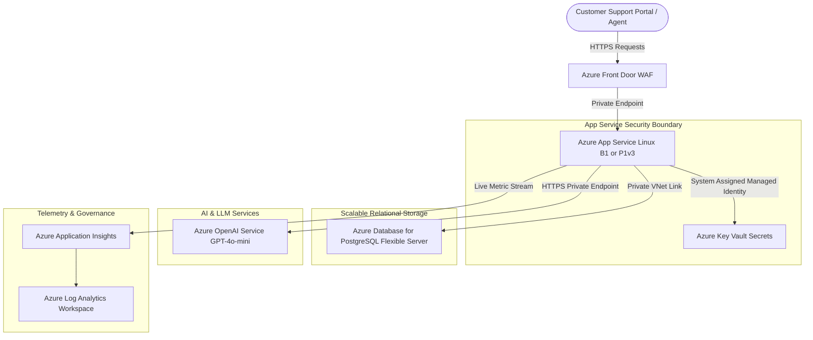
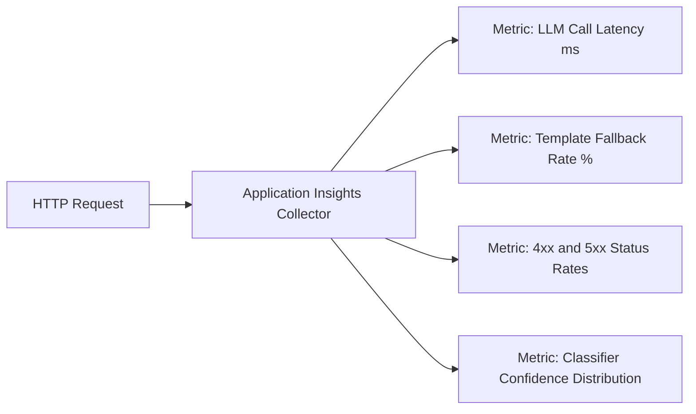

# Production Azure Architecture & Deployment Plan

**Problem ID**: PS04 - Azure Support Ticket Automation  
**Candidate**: Madhusudan Mudgal (Chitkara University, Roll No: 2310990812)  
**Target Environment**: Microsoft Azure Cloud

---

## 1. Enterprise Architecture Overview

The production architecture replaces ephemeral local components (SQLite, demo API keys) with highly available, compliant, and observable Azure PaaS offerings:



---

## 2. Component Selection & Trade-Offs

### A. Compute: Azure App Service (Linux)
- **SKU Recommendation**:
  - Development / Staging: `Basic B1` (1 vCPU, 1.75 GB RAM) for cost efficiency.
  - Production: `Premium P1v3` (2 vCPU, 8 GB RAM) for production load, zone redundancy, and zero-downtime deployment slots.
- **Why App Service over AKS/VMs**:
  - Eliminates Kubernetes control plane overhead for a standard REST API.
  - Native integration with Managed Identities, Key Vault references, and Application Insights.
  - Out-of-the-box support for blue/green deployment slots.

### B. Database: Azure Database for PostgreSQL (Flexible Server)
- **Local vs Production**: The local development server uses SQLite for zero-configuration testing. SQLite is single-writer and file-based, making it unsuitable for multi-instance horizontal scaling.
- **Production Choice**: Azure Database for PostgreSQL Flexible Server (`Burstable B1ms` for staging; `General Purpose D2ds_v5` for production).
- **Features**:
  - Native connection pooling via built-in PgBouncer.
  - Automated geo-redundant backups and Point-In-Time Restore (PITR).
  - VNet integration ensuring the database has no public IP address.

### C. Secrets Management: Azure Key Vault & Managed Identity
- **Zero Secrets in Code or Containers**: No API keys, database credentials, or connection strings are baked into Docker images or committed to Git.
- **Managed Identity**:
  1. The App Service is assigned an Azure **System-Assigned Managed Identity**.
  2. Azure Key Vault grants an Azure RBAC role (`Key Vault Secrets User`) to the App Service Principal.
  3. The App Service reads `GROQ_API_KEY` (or `AZURE_OPENAI_KEY`) using native **Key Vault References**:
     ```
     @Microsoft.KeyVault(SecretUri=https://kv-cerevyn-prod.vault.azure.net/secrets/GROQ-API-KEY/)
     ```

### D. Data Privacy & LLM Gateway Policy
- **Fictional Data Only**: During development, testing, and CI runs, only fictional ticket data is processed.
- **Production AI Provider**: Third-party public gateways (such as direct Groq public endpoints or local OmniRoute instances) are used strictly for local prototyping and candidate demonstration.
- **Enterprise Isolation**: In a production enterprise deployment, the endpoint points to **Azure OpenAI Service** deployed within the customer's private virtual network. Customer ticket data never traverses the public internet and is never used to train foundational models.

---

## 3. GitHub Actions CI/CD with OIDC Federation

To deploy securely without long-lived Azure service principal passwords, GitHub Actions authenticates using **Workload Identity Federation (OpenID Connect / OIDC)**.

### Step-by-Step OIDC Setup
1. **Create Microsoft Entra ID Application**:
   ```bash
   az ad app create --display-name "github-actions-cerevyn-ps04"
   ```
2. **Create Service Principal**:
   ```bash
   az ad sp create --id <APP_ID>
   ```
3. **Configure Federated Identity Credential**:
   Link the Entra application to the GitHub repository and branch:
   ```bash
   az ad app federated-credential create --id <APP_ID> --parameters '{
     "name": "github-actions-main-branch",
     "issuer": "https://token.actions.githubusercontent.com",
     "subject": "repo:madhusudan/Cerevyn-Chitkara-2310990812-PS04:ref:refs/heads/main",
     "description": "OIDC Federation for Main Branch Deployment",
     "audiences": ["api://AzureADTokenExchange"]
   }'
   ```
4. **Grant Subscription RBAC**:
   Assign the `Contributor` role scoped to the resource group:
   ```bash
   az role assignment create \
     --assignee <APP_ID> \
     --role "Contributor" \
     --scope "/subscriptions/<SUBSCRIPTION_ID>/resourceGroups/rg-cerevyn-prod"
   ```
5. **Configure GitHub Secrets**:
   - `AZURE_CLIENT_ID`: Entra Application Client ID
   - `AZURE_TENANT_ID`: Microsoft Entra Directory Tenant ID
   - `AZURE_SUBSCRIPTION_ID`: Azure Subscription ID

---

## 4. Observability & Application Insights Monitoring

Every request, ML prediction, and LLM call is monitored through Azure Application Insights:



### Critical Custom Telemetry Metrics
1. **`LLM_Call_Latency`**: Tracks external AI gateway latency (p50, p95, p99). An alert triggers if p95 exceeds 5.0 seconds.
2. **`Template_Fallback_Rate`**: Tracks the percentage of tickets routed to `TemplateClient` due to timeouts, rate limits (429), or invalid JSON. An alert triggers if fallback rate exceeds 5% over a 15-minute window.
3. **`Needs_Review_Percentage`**: Monitors the fraction of tickets falling below the confidence threshold ($< 0.35$). A sudden surge indicates model drift or novel vocabulary.
4. **`Audit Logging`**: Emits structured logs with `request_id`, ticket ID, category, and priority. The API key is masked and never recorded.

---

## 5. Cost-Control & Optimization Strategy

1. **Development / Free-Tier Sizing**:
   - App Service `F1 Free` or `B1 Basic` (~$13/month).
   - PostgreSQL Flexible Server `Burstable B1ms` (~$15/month).
   - Groq Free Tier / Azure OpenAI `gpt-4o-mini` (~$0.15 per million input tokens).
2. **Auto-Shutdown & Scheduling**:
   - Automated Azure DevTest Labs or automation runbooks to shut down staging instances outside business hours (cutting dev compute costs by ~65%).
3. **Azure Budgets & Alerts**:
   - Hard budget alert set at $50/month with SMS and email notifications at 80% and 100% thresholds.
4. **Rate Limit Defenses**:
   - In-app exponential backoff prevents aggressive retries that could incur excess API charges.
   - Immediate deterministic fallback to `TemplateClient` ensures service availability without runaway API bills.
