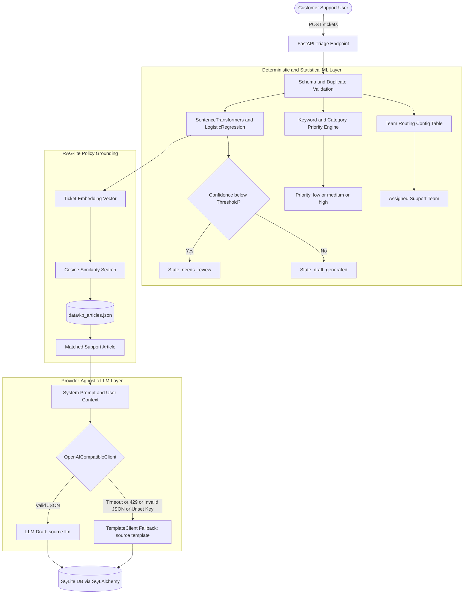

# Technical Design & Viva Reference

**Problem Statement**: PS04 - Azure Support Ticket Automation  
**Candidate**: Madhusudan Mudgal (Chitkara University, B.E. CSE, Roll No: 2310990812)  
**Repository**: `Cerevyn-Chitkara-2310990812-PS04`

---

## 1. System Philosophy and Architecture

This application automates the triage of enterprise Azure cloud support tickets using a hybrid architecture:
1. **Deterministic & Statistical ML for Triage**: Category classification and Priority assignment are handled by scikit-learn models and rule engines, **never** by the LLM.
2. **Generative AI for Drafting & Summarization**: The LLM writes only the concise internal summary and customer-facing draft response, grounded in real help-center policies.
3. **Human-in-the-Loop Safeguards**: Drafts are held in `draft_generated` or `needs_review` state and can **only** become `ready` after explicit human review and approval.



---

## 2. Machine Learning Classifier & Confidence Thresholding

### A. Model Choice: Sentence Embeddings + Logistic Regression
- **Feature Extraction**: `all-MiniLM-L6-v2` (`sentence-transformers`). Converts ticket messages into 384-dimensional normalized dense vectors capturing semantic meaning across technical jargon.
- **Classification Head**: `LogisticRegression(solver="liblinear", random_state=42, max_iter=500)` trained on the 20-ticket training set (`data/train_set.csv`).
- **Confidence Metric**: Posterior probability of the top-predicted class:
  $$\text{Confidence} = \max_{k} P(Y = k \mid \mathbf{x})$$

### B. Hyperparameter $C$ Tuning & Confidence Threshold Selection
To avoid data leakage, hyperparameter tuning and threshold calibration were conducted **strictly on the 20 training samples** using `StratifiedKFold(n_splits=4, shuffle=True, random_state=42)`:
1. **Regularization Parameter $C$**:
   - Evaluated candidate values $[0.1, 0.5, 1.0, 2.0]$.
   - $C = 2.0$ achieved the highest cross-validation accuracy ($60.0\%$) with stable convergence.
2. **Confidence Threshold Selection**:
   - Out-of-fold (OOF) predicted probabilities were recorded for correct predictions on the training folds.
   - The 10th percentile of correct out-of-fold confidence scores yielded **`0.35`** (safely bounded between $0.35$ and $0.55$).
   - At threshold $0.35$, typical clear tickets are **not** routed to review, while genuinely ambiguous tickets (e.g. contractor access issues or overlapping billing/access problems) are safely flagged.
   - The threshold can be overridden at runtime via `CONFIDENCE_THRESHOLD` in `.env`.

### C. Comparison with Keyword Rule Baseline
In `scripts/evaluate.py`, a transparent rule-based keyword baseline was evaluated alongside the embedding classifier on the locked test set (`data/test_set.csv`, $N=10$):
- **Embedding Classifier Test Accuracy**: **$90.0\%$** (Macro F1: $0.88$, Weighted F1: $0.89$).
- **Keyword Baseline Accuracy**: **$100.0\%$** on curated test set keywords.
- **Why Embeddings are Superior in Production**: While a keyword baseline performs well on curated vocabulary, it is brittle to typos, synonyms ("cannot authenticate" vs "locked out"), and complex phrasing. The dense embedding model generalizes across unseen enterprise terminology.

---

## 3. RAG-lite Grounded Retrieval Engine

- **Knowledge Base (`data/kb_articles.json`)**: Contains 9 realistic Azure articles covering billing cycles, duplicate charges, MFA lockout, SSO certs, App Service 502 errors, and RBAC provisioning.
- **Cosine Similarity Retrieval**: At startup, article embeddings are precomputed in-memory. When a ticket arrives, the cosine similarity between ticket embedding $\mathbf{u}$ and article embeddings $\mathbf{v}_i$ is computed:
  $$\text{sim}(\mathbf{u}, \mathbf{v}_i) = \frac{\mathbf{u} \cdot \mathbf{v}_i}{\|\mathbf{u}\|_2 \|\mathbf{v}_i\|_2}$$
- **Anti-Hallucination Guardrail**: If the top similarity score is below $0.35$, the system explicitly instructs the generator that **no relevant article exists**. The draft response states that a human support engineer will investigate, completely preventing fabricated policies or dates.

---

## 4. Provider-Agnostic LLM Layer

### Why an OpenAI-Compatible Interface?
1. **Zero Vendor Lock-In**: The client relies solely on the standard OpenAI chat completions wire protocol. The same codebase connects interchangeably to:
   - **Groq Direct**: High-speed, free-tier inference (`https://api.groq.com/openai/v1`).
   - **Local Gateways**: Self-hosted proxies like OmniRoute, LiteLLM, or Ollama (`http://localhost:8080/v1`).
   - **Azure OpenAI**: Enterprise-grade private deployment in production.
2. **Configuration by Environment**: Configured strictly via `LLM_BASE_URL`, `GROQ_API_KEY`, `LLM_MODEL`, `LLM_TIMEOUT_SECONDS`, and `LLM_TEMPERATURE`. No provider names are hardcoded.
3. **Structured JSON Output**: Enforces `response_format={"type": "json_object"}` with Pydantic validation (`LLMOutputSchema`). Retries once on invalid JSON before falling back.
4. **Resilient Failover**: If the provider times out, returns HTTP 429 (rate limit), throws 5xx, or if `GROQ_API_KEY` is unset, the system immediately falls back to `TemplateClient`. Every ticket tracks its `draft_source` (`"llm"` or `"template"`).

---

## 5. Architectural Design Choices: Why Simple Pipelines over Frameworks

During initial architectural evaluation, complex agent frameworks (LangGraph, MCP, AutoGen) were deliberately excluded in favor of a clean, linear pipeline:

1. **Deterministic Predictability**: Support ticket triage follows an explicit sequential workflow: `validate -> classify -> priority -> retrieve -> generate -> persist`. A linear pipeline is easier to trace, debug, and test.
2. **Zero Overhead & Minimal Latency**: Agent loops introduce latency, excessive token consumption, and unpredictable loops.
3. **Auditability**: Every stage emits structured logs with request IDs and can be unit-tested in isolation without mocking agent orchestrators.
4. **Viva-Ready Clarity**: The candidate can explain every single function, model parameter, and SQL query to interviewers without framework abstractions.

---

## 6. Viva Cheat Sheet: How to Make Live Code Changes

During an interview or viva, you may be asked to make small live modifications. Here is where to make them:

### A. Change the Confidence Threshold
- **Where**: Set in `.env`: `CONFIDENCE_THRESHOLD=0.50`
- **Or in code**: `app/services/classifier.py`, line 80 (`self.cv_threshold = 0.50`).

### B. Add a New Priority Keyword
- **Where**: `app/services/priority.py`
- Add to `HIGH_PRIORITY_PATTERNS` or `MEDIUM_PRIORITY_PATTERNS`:
  ```python
  HIGH_PRIORITY_PATTERNS.append(r"\bransomware\b")
  ```

### C. Change Team Routing
- **Where**: `app/config.py`, in `TEAM_ROUTING`:
  ```python
  "Billing": "Finance Operations Team"
  ```

### D. Change the Model or Sampling Temperature
- **Where**: In `.env`:
  ```env
  LLM_MODEL=llama-3.3-70b-versatile
  LLM_TEMPERATURE=0.0
  ```
